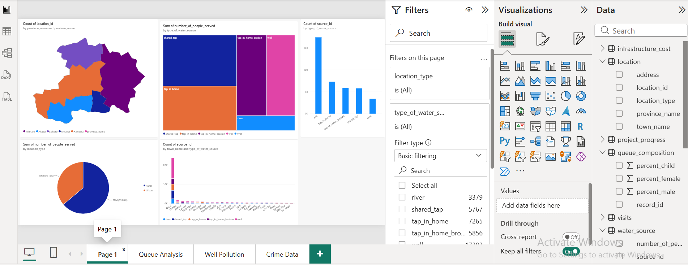
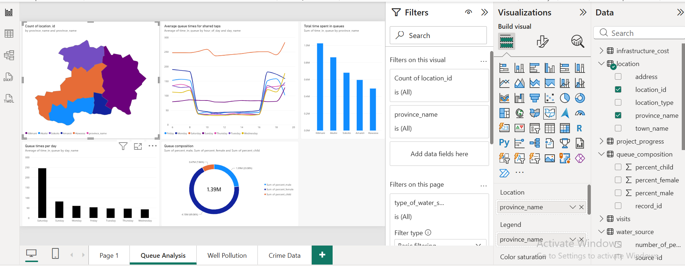
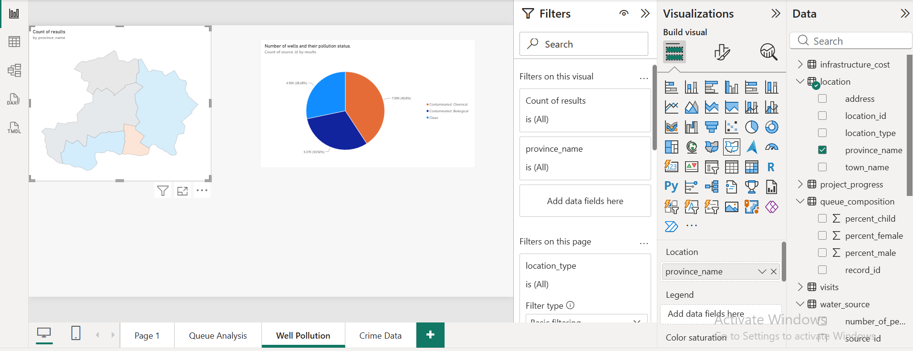
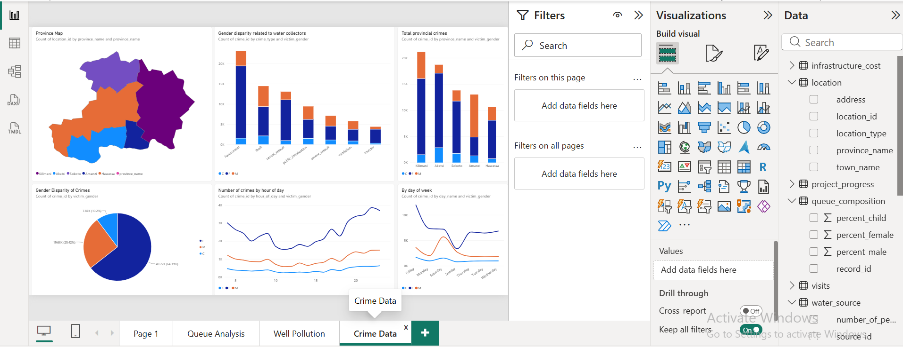

# Maji Ndogo Water Systems & Data Audit

## Project Overview

This is a data analytics training project completed as part of my ALX Data Analytics learning journey. The project explores water-service data using SQL and Power BI, with a focus on database auditing, data quality, and visual reporting.

## Project Objectives

- Investigate potential data-entry errors in water-service records.
- Examine surveyor information and statements using SQL.
- Compare auditor scores with recorded water-source information.
- Present findings through interactive Power BI report pages.

## Tools Used

- SQL: Database queries, filtering, data auditing, and analysis.
- Power BI: Data visualization, interactive reports, and dashboard development.
- Excel: Data organization and supporting analysis, where applicable.

## SQL Analysis

My SQL work included:

- Exploring the `md_water_services` database.
- Reviewing records in the `Incorrect_records` table.
- Investigating surveyor-related records and auditor information.
- Using `LIKE '%cash%'` to search statements containing the word "cash".
- Examining auditor scores in relation to recorded water-source types.

The queries and their findings should be reviewed alongside the corresponding SQL scripts.

## Power BI Dashboard

The report contains four pages covering the following topics:

1. Water Sources Overview — overview of water sources and service access.
2. Queue Analysis — analysis of water-collection queues and related demographics.
3. Well Pollution Analysis — exploration of well pollution and contamination.
4. Crime and Safety Analysis — exploration of crime and safety information in relation to water access.

## Dashboard Screenshots

### 1. Water Sources Overview

This dashboard page provides an overview of water sources and water-service access, helping readers explore the distribution of water sources across the areas covered by the dataset.

### 2. Queue Analysis

This page explores water-collection queues and related demographic information, helping readers examine patterns in how people access water services.

### 3. Well Pollution Status

This page focuses on recorded well pollution status and water-quality concerns, supporting the exploration of potential environmental health risks.

### 4. Crime and Safety Analysis

This page explores crime and safety information in the context of water access, helping readers investigate safety-related factors associated with collecting water.

## Key Skills and Learning Outcomes

End-to-End Data Analysis: Practised working across SQL-based database auditing and Power BI visualization to explore water-service data and communicate analytical findings.

1. Database Auditing and Data Quality (SQL): Gained hands-on experience querying the `md_water_services` database, reviewing the `Incorrect_records` table, investigating surveyor-related discrepancies, applying wildcard text searches using `LIKE '%cash%'`, and examining auditor scores alongside recorded water-source information.

2. Interactive Data Visualization (Power BI): Developed a multi-page Power BI report covering Water Sources Overview, Queue Analysis, Well Pollution Status, and Crime and Safety Analysis. These report pages support the exploration of water access, collection queues, water-quality concerns, and safety-related information.

3. Data Interpretation and Communication: Practised organizing analytical information into visual reports that help readers explore patterns related to water-service delivery, data quality, environmental health, and community safety.

4. Transferable Skills: Applied analytical approaches relevant to healthcare data, including data-quality review, structured querying, identifying discrepancies, and presenting information to support evidence-based decision-making.

## Project Structure

- `sql/` — SQL analysis scripts and SQL documentation.
- `Maji_Ndogo_P2_Water_Sources_Overview.png` — Water Sources Overview dashboard screenshot.
- `Maji_Ndogo_P2_Queue_Analysis.png` — Queue Analysis dashboard screenshot.
- `Maji_Ndogo_P2_Well_Pollution_Status.png` — Well Pollution Status dashboard screenshot.
- `Maji_Ndogo_P2_Crime_and_Safety_Data.png` — Crime and Safety Analysis dashboard screenshot.
- `README.md` — Main project overview, objectives, tools, and dashboard documentation.

## Project Context

This is a training project completed as part of my ALX Data Analytics learning journey. The analysis and visualizations should be interpreted in the context of the original training dataset and project requirements.
